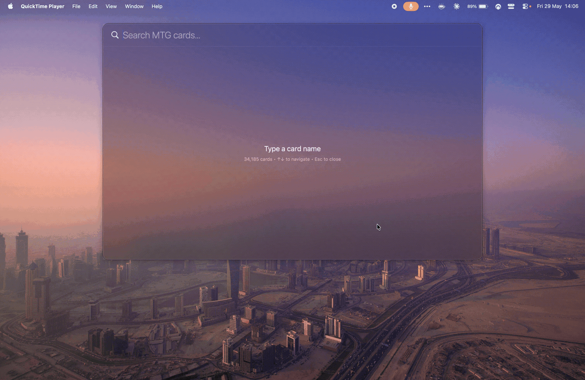
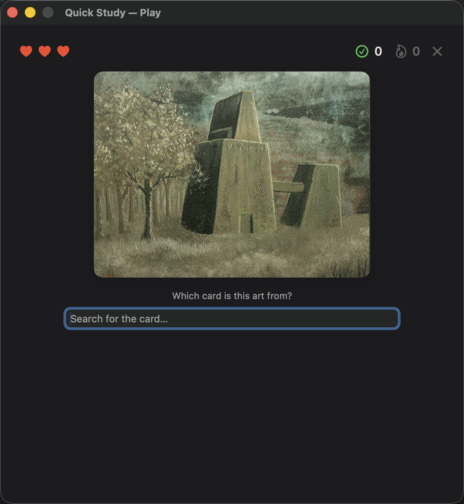

TL;DR - I built [Quick Study](/apps/quick-study/), a small Spotlight-style macOS menu-bar app for looking up Magic: The Gathering cards. Global hotkey, type a name, see the card - fully offline after a single sync. Free on the Mac App Store as [MTG Quick Study](https://apps.apple.com/app/mtg-quick-study/id6792768370?mt=12).

---

Magic. I can pivot from any topic to Magic: The Gathering in two sentences - challenge proposed. But after triumphant losses at two recent pre-releases at my local game store, I had to face the music: I love the game, and I suck at actually playing it.

The book everyone points at is Reid Duke's *Level One*. It reads less like a strategy guide and more like a deliberate-practice manual: tempo, card advantage, mulligans, sequencing. The catch - you can't really read a chapter on removal without twenty removal spells in front of you.

My main reading time is the commute, on a train route that, charmingly, has no working WiFi. Phone signal is hit-or-miss. So the book opens; the cards don't. [Scryfall](https://scryfall.com) is online-first. The official app is online-first. Browser tabs are online-first. The closest thing I had was ManaBox (my favorite collection tracker), but it ships card text only as a fallback - no images - and frankly, it doesn't spark joy.

So I built the thing.

# What it is

A small macOS menu-bar app, Spotlight-style: press a global hotkey (**⌥⌘M** by default), a panel opens, type a partial name, see the card - full image, oracle text with inline mana symbols, and every printing it ever had. Fully offline after a single sync: it pulls Scryfall's free bulk card data and images once, then never asks the network again.

Search is instant because the index is local - sub-millisecond fuzzy ranking over ~25k cards, held in memory. That matters more than it sounds when you're flipping between book and screen every few seconds. The ranking is layered (exact → prefix → word-start → substring → initials), so short exact names win on ambiguous queries, and you can narrow things down with Scryfall-style inline filters right in the search box: `r:rare`, `t:creature`, `o:"draw a card"`, or `goblin t:creature -t:legendary` if you're feeling fancy.

A few things grew around the core lookup, because side projects are where scope goes to creep:

* **Card lists** - build a wishlist or a deck shell in a collapsible side column.
* **Recently Added** - freshly-spoiled cards surface as soon as they hit your local database, newest first.
* **Play mode** - two endless-survival games built from the artwork you've already cached: *Guess the Card* and *Guess the Artist*. Three lives. I am not proud of my best streak.

# The name

For the MTG readers: [Quick Study](https://scryfall.com/search?q=%21%22Quick+Study%22) is a blue Strixhaven instant. Two cards for three CMC, both card advantage and spell advantage, great with spell mastery, flashback, and assorted shenanigans. A simple little card. The app is the same energy.

# The parts I actually care about

Building a small, single-purpose tool for a single-person problem is still worth doing, and it's easier than ever. Yes, I vibed the whole thing - it's Swift and SwiftUI, and the bar for "worth shipping" has drifted upward over the years, and it shouldn't have.

**Offline-first isn't nostalgia; it's a discipline.** It forces honest answers about what data you actually need, and when. Here the answer turned out to be: one bulk fetch from Scryfall's API into a local SQLite database, an on-disk image cache (~4 GB if you want every card image, optional), and a background check that quietly ingests new spoilers when you *do* have a connection. Everything else - search, preview, printings, even the games - runs off that local copy. No accounts, no telemetry, no spinner on a moving train.

# Installation

Quick Study is free on the Mac App Store as [MTG Quick Study](https://apps.apple.com/app/mtg-quick-study/id6792768370?mt=12). It needs macOS 14 or later on an Apple Silicon Mac. There's a landing page at [/apps/quick-study/](/apps/quick-study/) too.

*Update: it used to be a Homebrew cask with the source on GitHub. The tap is retired and the `brew` command no longer works.*

Let it download the card database once, and you're set.

# It's not really about Magic

It's MTG today, but the shape - bulk-fetch, local DB, menu-bar search - generalizes. Any reference corpus you want at your fingertips offline could live in this skeleton: another card game, a rules glossary, a different study domain entirely. If you just want to use it, it's on the App Store.

This isn't the only offline tool I've built lately, but the others can wait for another post (and we all know what my "another post" promises are worth).

Cheers! 🚂
